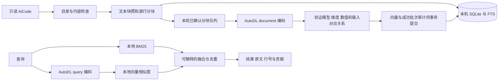

# AiCode 目录检索执行汇总

> 整理日期：2026-10-18，北京时间。数据库状态采样于 22:18:47，研究进度截止 22:19:32，在线健康检查采样于 22:19:31。实现基线为提交 `1f84dc9`。

针对本机 `~/AiCode` 的代码与文档检索，已经完成过滤、快照入库、按行切块和已纳入范围的向量补齐：**66 个项目、62,109 个含分块文件、222,977 个文本分块，兼容向量覆盖率 100%**。期间修复了运行副本污染、FTS 更新低效、扫描阻塞编码、中文查询规划和文本媒体标记触发远端故障等问题。

当前仍有两个需要分别验收的环节：**在线推理入口尚未恢复可用，检索质量研究尚未完成**。本地已有索引可以执行 BM25，冻结快照也可以使用已缓存的查询向量继续研究；这两点都不能证明实时语义查询已经恢复。

本文记录实际执行过程和结果。系统机制与操作参数见[完整方案](OMNIINDEX_SOLUTION.md)，安装与调用见[代码检索说明](CODE_SEARCH.md)，实验约束见[研究说明](CODE_SEARCH_RESEARCH.md)。

## 1 任务范围与交付内容

这里的 AI Code 指本机 `~/AiCode` 目录，执行程序位于 OmniEmbedding 仓库，两者不是同一个目录。源目录只读；索引、任务、向量和查询记录保存在 `data/code-search/`，没有为了索引而执行源目录中的程序，也没有将其中的 README、AGENTS 等文字当作操作授权。

| 环节 | 已实现的交付 | 实际边界 |
|---|---|---|
| 读取 | 目录剪枝、文件与凭据特征检查、UTF-8 校验 | 只纳入符合规则的文本；不等于目录中的全部格式都已解析 |
| 入库 | 完整文本快照、原始行号、内容哈希、带重叠的分块 | 结果对应上次扫描的版本，源文件变化后需要增量同步 |
| 编码 | AutoDL 的 document/query 编码，固定模型版本 | 本机不需要 PyTorch 或模型；远程编码需要上传通过检查的文本 |
| 检索 | BM25、精确向量相似度、加权 RRF 融合 | 向量索引不是 ANN，也没有普遍可靠的无答案拒绝能力 |
| 查看 | 本机 Web、原文、向量、贡献分、任务与批次 | 默认仅监听 `127.0.0.1:8790`，没有多人账户体系 |
| 验收 | 固定题集、独立快照、参数试验与质量门槛 | 测试通过、编码完成和相关性达标分别判断 |

PDF、Office、图片、音视频、压缩包、模型、数据库和 Notebook 等格式没有在本轮解析为正文。SVG 等可读文本则可能按文本规则入库，因此“图片未解析”不意味着所有图形文件扩展名都不存在于索引。

## 2 当前完成状态

### 2.1 文件 分块与向量

以下数量来自同一个 SQLite 只读事务，避免把不同时间的分子、分母拼成覆盖率。

| 项目 | 数量或状态 |
|---|---:|
| 数据库登记文件记录 | 78,301 |
| 状态为 indexed 的文件 | 62,589 |
| 其中实际包含分块的文件 | 62,109 |
| indexed 但无分块的文件 | 480 |
| 跳过的文件记录 | 15,712 |
| 包含可检索内容的项目 | 66 |
| 分块 / FTS 条目 / 兼容向量 | 各 222,977 |
| 待生成的兼容向量 | 0 |
| 孤儿分块 / 孤儿向量 | 各 0 |
| 向量覆盖率 | 100% |

78,301 是已登记记录数，62,589 是文件状态计数，62,109 是实际有分块的文件数，不能混用。被整体剪枝的目录不会把全部后代文件逐一登记，因此 78,301 也不是 `~/AiCode` 所有磁盘文件的总数。

“完整覆盖”指 **222,977 个已索引文本分块都已有匹配模型版本的向量**，并不包括被跳过、尚未支持解析或扫描后新增的文件。

当前空间固定为：

```text
模型       google/embeddinggemma-2
revision   914f7f89142e33e77833254d9c9b90c3cef7303b
向量维度   768
分块策略   line-v1:2400:6
词项策略   code-camel-cjk-bigram-v1
```

当前跳过记录中，二进制或生成文件 11,087 个、二进制内容 1,814 个、疑似敏感内容 1,736 个、超长源行 571 个、敏感路径 220 个、符号链接 148 个、超过大小限制 136 个。这些是规则命中的分类，不能直接解释成真实凭据数量，也不能由此推断发生了凭据外泄。

来源：[当前数据库快照](../data/aicode-execution-summary-20261018/current-evidence.json)。

### 2.2 最后一次续跑与历史批次

最后一次任务只执行 `embed`，从 **21:25:24** 运行至 **21:40:02**，补齐缺失的 **27,411 条向量**，成功批次 **2,036**、失败批次 **0**。修复前已有的 **195,566 条向量**在完成时复核完整字段与二进制摘要，保持一致。

这不是整个执行历史没有失败。当前共有 **15,476 条批次记录**：15,471 次成功、5 次失败。成功记录覆盖 222,973 个唯一分块输入，另有最初验收产生的 **4 条向量没有成功批次输入审计**，需要保留这个历史缺口，不能补造记录后宣称全部可追溯。

历史 5 个失败批次涉及的 77 条输入，现在都能找到相同分块 ID、相同输入哈希的后续成功审计及已保存向量。其中 4 个明确 HTTP 503 批次共 61 条，另一个 HTTP 状态未记录批次共 16 条。这里是记录关联核对，不是重新对私有正文做完整哈希验收。

来源：[补齐与恢复验收](../data/code-search/maintenance/heartbeat-20261018-2135/REPORT.md)、[当前审计交叉核对](../data/aicode-execution-summary-20261018/current-audit-crosscheck.json)。

## 3 详细执行时间线

下表均为 2026-10-18 北京时间。早期数字是当时的快照，不能作为当前状态使用。

| 时间 | 执行动作与发现 | 结果及后续影响 |
|---|---|---|
| 18:07 首轮同步；18:28 审查 | 72,875 个分块仅有 4 条验收向量；`OmniVoice/.data` 中的运行记录占当时分块约 74.03% | 识别到语料污染、扫描阻塞编码和 FTS 更新低效，先修入库再谈召回 |
| 18:38—18:45 | 暂停并备份索引，迁移 FTS 定位；清理 11,717 个文件记录、67,422 个分块，另清理 Swift 构建相关 62 个文件、169 个分块 | 清理的是索引记录，保留源目录；已有 4 条向量保留，恢复交错扫描与编码 |
| 18:44 | 尝试在 56,036 分块、5,118 向量的不完整快照研究 | 因覆盖等门槛被 blocked，没有把不完整语义比较算成有效提升 |
| 18:50 | 构建独立 500 分块实验库并补齐 500 条向量 | 保留目标证据、加入困难干扰项和固定种子抽样；不改生产库 |
| 18:53—18:57 | 固定较大快照改进 BM25；在小库尝试融合参数 | 保守查询优化有效；更强扩词及不满足留出集门槛的权重方案被拒绝 |
| 18:58 | 258 项回归、8 项子测试及 40 个来源样本核查通过 | 确认本轮修复行为；测试环境用独立环境解决 NumPy/SciPy ABI 冲突 |
| 19:13 扫描结束；19:16 观察 | 最终扫描范围有 62,109 个含块文件、222,977 个分块；19:16 已有 38,945 条向量 | 扫描完成，编码继续；当时向量覆盖仅约 17.47% |
| 20:12—20:29 | 连接或响应读取类故障，已保存 178,589 条向量；仅续缺失向量 | 已提交结果保留；另修复响应中断时丢失已知 HTTP 状态的审计问题 |
| 20:33—21:04 | 多次明确 503，停止无限恢复并定位真实处理器行为 | 源码中的媒体保留标记被误当附件占位符；未把先前连接故障强行归为同因 |
| 20:57 | 等待全量覆盖的旧研究超时 | 没有产生新的全库质量结论 |
| 21:25—21:28 | 部署文本标记处理及输入错误隔离，仅续缺失 27,411 条 | 相关回归与真实接口验证通过；约 181 秒增加 6,096 条向量，19/19 次就绪检查通过 |
| 21:40:02 | 续跑自然完成 | 222,977 分块全部补齐；42 个媒体标记唯一分块和历史 4 个 503 批次逐项恢复 |
| 21:40:48 | 既有研究进程冻结全量 SQLite，绑定题集、算法和查询向量 | 固定 17 题、17 条已缓存查询向量，最多 6 组开发集参数比较，不新增查询编码 |
| 22:02—22:04 | 推理公网入口的 live/ready 均返回 AutoDL nginx HTML 404 | 只确认公网入口不可用，没有证明实例关机、GPU 故障或模型进程已退出 |
| 22:04—22:05 | 809 项测试、91 项子测试及浏览器流程验证通过，代码推送到 main | 发布提交 `1f84dc9`；在线语义验收受 404 阻断，BM25 及明确降级流程得到验证 |
| 截至 22:19 | 全量研究已完成前两组开发试验，第三组进行中；新健康检查 ready=false | 尚无最终推荐，不变更生产参数，在线可用性与离线研究分别处理 |

阶段原始路径和核对结果见[时间线证据摘要](../data/aicode-execution-summary-20261018/history-evidence.json)。

## 4 入库与 AutoDL 编码实际如何执行



扫描首先剪枝 `.git`、依赖、构建、缓存和运行历史等目录，再检查文件、符号链接、UTF-8 和疑似凭据。安全检查覆盖原始文本，也覆盖添加路径与行号后的实际上传文本。通过检查的正文保存在本机快照中，按原始行切块，目标 2,400 字符、最多 6 行重叠；单文件上限 1 MiB，单条实际上传文本上限 8,192 字符。

扫描和编码交错执行：已确认的文件可以先进入有界批次，不必等全部目录扫描结束。每批最多 16 个分块、总文本最多 32,768 字符，使用 document 角色送往 AutoDL。返回结果通过模型版本、维度、行数、有限值与单位范数校验后，与成功批次审计一起提交。本轮失败不会撤销先前已提交的向量；续跑只选择当前兼容空间中缺失的分块。

查询时，BM25 在本机执行；语义路通过 AutoDL 编码查询，再对本地向量做精确相似度检索，最后按 RRF 融合排名。默认混合只有在查询范围内向量完整时启用正常两路融合；覆盖或远端状态不满足要求时，页面必须明示实际使用的召回方式，不能把词项结果标成成功的语义检索。

**本地保存索引不等于源码没有离开本机。** 通过过滤的文本分块和需要编码的查询会发送到配置的 AutoDL 端点。凭据特征检查可以降低误传风险，但不能识别全部业务秘密；涉及不得外发的项目，下一步应先设置项目级上传范围。

字符限制也不等于模型 token 限制；目前没有逐条 token 覆盖审计，不能声称所有长分块均已证明不存在模型截断。

实现入口：[入库与任务](../omniembed/code_search/ingest.py)、[快照与审计](../omniembed/code_search/store.py)、[检索](../omniembed/code_search/search.py)。

## 5 关键问题与修复结果

| 问题 | 实际处理 | 验证结果与保留边界 |
|---|---|---|
| 运行记录、重复副本和构建结果淹没正式资料 | 先暂停、备份，再调整目录剪枝和清理索引 | 源目录保留；清理后重新形成最终文本范围，不能把删掉噪声全部归功于模型 |
| FTS 更新反复扫描全表 | 保存分块到 FTS rowid 的映射，按关联定位更新 | 降低更新不必要的全表访问，迁移不要求重新编码兼容向量 |
| 扫描结束前几乎没有编码 | 扫描与有界编码批次交错，保留取消与续跑状态 | 更早出现可用向量，但中途全局分母仍可能增长 |
| 中文查询意图、CamelCase 与短标题证据丢失 | 修正词项规划、项目约束、主题覆盖和保守重排 | 同快照开发题改善；更强扩词并非更好，已拒绝退步版本 |
| 部分覆盖的混合结果容易误导 | 按查询范围计算覆盖，显示部分索引或明确降级 | 页面保留提交查询时的范围，不能用最新库统计替换历史查询状态 |
| 文本媒体标记触发 processor 异常并升级为 503 | 部署 `media-literals-space-v1`，只在模型输入阶段把精确标记加可见空格；严格区分输入错误与未知推理故障 | 原文快照、上传原始哈希与 BM25 不变；真实图片/视频通路保留 |
| 响应读取中断丢失已知 HTTP 状态 | 改进客户端状态诊断与脱敏日志 | 与媒体标记修复分别记录；不把所有网络问题归为同一原因 |
| 搜索界面混入过多统计和原始 JSON | 搜索入口聚焦问题、模式和项目，统计集中资料库，详情逐步展开 | 发布记录验证桌面/移动、筛选草稿、历史覆盖、来源与分页 |

媒体标记修复的证据包括 220 项相关本地回归、实际处理器的 6 项 CPU 对照、5 个原失败样例，以及文本标记文档、查询、合成图片和视频的 4 次真实接口验证。普通文本的 token ID 哈希保持一致，真实媒体通路未被替换成纯文本处理。

此次故障说明：**ready 在某一时刻通过，不代表后续业务输入都能稳定编码。** 修复验收因此同时检查了原失败输入、连续编码、向量保留和历史失败的自然恢复，而不只是重启后读取一次健康状态。

来源：[编码故障修复记录](../data/code-search/maintenance/repair-20261018-media-markers/REPORT.md)。

## 6 质量研究与已经得到的结果

### 6.1 固定较大快照的 BM25 改进

同一份归档语料、同一组 10 道开发题，比较查询规划与排序实现：

| 版本 | MRR@10 | 指定证据 Recall@10 |
|---|---:|---:|
| 第二轮优化前 | 0.1000 | 0.10 |
| 保守优化 | 0.6444 | 0.80 |
| 更强标题与扩词方案 | 0.5167 | 0.70 |
| 该轮最终保守归档版 | 0.6533 | 0.80 |

较差的扩词方案被拒绝。“OmniVoice 架构”在修复后的词项检索前 3 条包含当前架构文档；另一个独立完整子集上的混合检索把指定架构证据排到第 1。这是两个范围不同的例子，不能合并成全库 Top1 结论。

这些分数绑定当时的算法和固定快照。后续正确性修复、语料扩大之后，不应继续把历史分数当成当前版本的重新实测值。

### 6.2 独立 500 分块实验与被拒绝的选参

为避免全量向量未完成时进行不公平比较，另建 500 分块、500 向量的完整实验库。该库刻意保留目标证据，加入开发集 BM25 的困难候选和按项目抽样的干扰项，不是整个目录的自然随机样本。

10 道开发题、每路候选 100、默认向量权重 0.6 的归档结果：

| 模式 | 改进前 MRR@10 | 改进后 MRR@10 | 改进前 Recall@10 | 改进后 Recall@10 |
|---|---:|---:|---:|---:|
| BM25 | 0.5250 | 0.6601 | 0.60 | 0.90 |
| Vector | 0.5250 | 0.5250 | 0.70 | 0.70 |
| Hybrid | 0.5167 | 0.6333 | 0.70 | 0.70 |

改善主要来自词项处理与排序，没有显示模型本身的语义能力提高。混合召回也没有在全部指标上胜过 BM25。

开发集选出的向量权重 0.35，在留出集 6 道可回答题上的 MRR 从默认参数的 **0.8889 降至 0.8333**，无答案题准确率仍为 **0**。因此研究结果为 `blocked`，生产默认权重保留 **0.6**，没有为了“通过”降低门槛或改 gold。

### 6.3 全量冻结快照的进行中研究

21:27 已启动等待、21:40:48 冻结全量快照的既有研究使用完整索引：FTS 和分块均为 222,977，外键错误 0；算法、17 道题和 17 条绑定查询文本哈希的缓存向量固定。最多比较 6 组参数，先在 development 选择，再检查 baseline 与所选方案的 holdout，没有重新调用 GPU 编码查询。

截至 22:19:32，前两组试验已完成开发集，第三组已开始，尚无 `recommendation.json`：

| 全量快照的 10 道开发题 | MRR@10 | Recall@10 |
|---|---:|---:|
| BM25 | 0.6033 | 0.80 |
| Vector | 0.3500 | 0.50 |
| Hybrid，向量权重 0.6 | 0.4833 | 0.70 |
| Hybrid，向量权重 0.35 | 0.5736 | 0.90 |

权重 0.35 在开发集的指定证据 Recall@10 更高，但还没有经过本轮留出集验收；默认混合在该组题上也未优于 BM25 的 MRR。当前不能据此切换生产参数，更不能宣称全 AiCode 的总体准确率达到某个百分比。

17 题由 10 道开发题和 7 道留出题组成，主要围绕 OmniVoice，补充少量其他项目、精确符号和无答案问题。指标测量的是**指定文件和行段的证据命中**；多个正确替代段落可能未被 gold 覆盖。下一步需要跨项目的新问题与独立标签，而不是继续针对这 17 题反复调参。

来源：[归档实验解释](OMNIINDEX_SOLUTION.md#8-已有评测证据与适用范围)、[本轮冻结研究](../data/code-search/evaluations/research-20261018T132724Z-7b04a562/events.jsonl)、[研究状态采样](../data/aicode-execution-summary-20261018/history-evidence.json)。`evaluations/latest.json` 仍可能指向旧的 500 分块研究，应按研究目录和时间识别最新进度。

## 7 当前在线状态与发布结果

### 7.1 AutoDL 的历史成功与当前故障

21:25 修复后的真实接口验证成功，21:40 补齐结束时就绪状态正常。随后 **22:02—22:04**，已配置推理公网入口的 `/health/live` 和 `/health/ready` 返回 AutoDL nginx HTML 404。这是推理入口的响应，不是 AutoDL 控制面 API 的 404，也不能仅凭它认定实例已经关机或 GPU 故障。

本次 **22:19:31** 只读调用本机 `/api/code/health`，结果为：

```json
{
  "configured": true,
  "ready": false,
  "status": "unavailable",
  "message": "操作失败（URLError）；详细数据未写入错误信息"
}
```

本机状态接口自身返回 HTTP 200，表示接口能响应；**不表示远端推理健康**。这次只能确认远端就绪检查失败，不能把之前的 404 当作本次已经确认的错误码，也没有证据确定更底层原因。

使用 AutoDL 的架构仍可把 GPU 与本机应用分开：已保存向量留在本机，模型环境可独立维护。但持续可用依赖实例运行、端口映射、连接资料和模型状态。应先恢复并验收当前入口，再把在线语义检索视为可用；离线缓存研究可以独立继续。

来源：[此前 404 分析](../data/code-search/maintenance/ui-review-20261018/remote-404-analysis.json)、[本次健康采样](../data/aicode-execution-summary-20261018/health-current.json)。

### 7.2 代码与界面验证

22:04 的发布记录显示，在隔离依赖环境中 **809 项测试、91 项子测试通过**，另有 5 条弃用警告。浏览器记录覆盖桌面与移动布局、提交范围与未提交筛选的区分、历史查询覆盖、来源详情和分页。在线语义流程当时因 404 未完成验证，BM25 及混合模式明确回退得到验证。

22:05 推送的提交为 [`1f84dc9`](https://github.com/DataSky/OmniEmbedding/commit/1f84dc96c1cc21b03213b947dab426bde7b33998)，包含本地代码检索、网页、评测工具和修复。本次整理复核了已有发布记录，未重新执行上述全部测试，也未重启服务、重建索引或追加 GPU 推理任务。

来源：[发布清单](../data/code-search/maintenance/ui-review-20261018/release-manifest.json)。

## 8 下一步验收顺序

1. **恢复在线推理入口。** 核对当前实例状态、映射和连接资料，分别验证 live、鉴权 ready 和一条真实 query/document 请求；入口未确认前，不用循环重装或盲目续跑代替诊断。
2. **让既有全量研究完成。** 保持同一快照、题集、查询缓存和门槛，不重复启动实验；根据最终留出集、无答案题与相对回退判断，而不是只看开发集最高分。
3. **补独立质量证据。** 增加项目均衡的自然语言问题、精确符号、版本冲突和无答案问题；用盲审候选池补充替代正确证据，将已有 17 题逐步转为回归集。
4. **按问题类型验证检索策略。** 现有数据没有证明向量权重越大越好。可以比较精确标识符优先 BM25、自然语言主题采用混合的策略，但需先独立评测，不直接写入生产默认值。
5. **明确上传与审计边界。** 为不得外发的项目设置显式上传范围；保留最初 4 条向量缺少成功批次审计的历史事实，今后继续让新向量与成功审计同事务落库。
6. **制定数据和磁盘保留策略。** 主库、WAL、备份和全量研究快照都会占空间。运行中备份使用 SQLite 一致性备份接口，不只复制主库，更不要手工删除 WAL。停止本机应用不会关闭 AutoDL 或停止远端计费。

## 9 证据与文档索引

仓库文档用于长期说明实现；下列 `data/` 路径是本机私有运行证据，不随 Git 发布，克隆仓库后不会自动获得。汇总未复制私有源码正文、服务密钥、媒体或完整向量。

| 用途 | 来源 |
|---|---|
| 当前数据库计数与模型空间 | [current-evidence.json](../data/aicode-execution-summary-20261018/current-evidence.json) |
| 成功输入、历史失败恢复与 4 条审计缺口 | [current-audit-crosscheck.json](../data/aicode-execution-summary-20261018/current-audit-crosscheck.json) |
| 详细历史与研究进度采样 | [history-evidence.json](../data/aicode-execution-summary-20261018/history-evidence.json) |
| 本次只读远端就绪状态 | [health-current.json](../data/aicode-execution-summary-20261018/health-current.json) |
| 首轮污染清理和检索修复 | [repair summary](../data/code-search/evaluations/repair-20261018/summary.json) |
| 500 分块专项基准 | [benchmark manifest](../data/code-search/evaluations/benchmark-20261018-round1/manifest.json) |
| 小库选参被拒绝的原因 | [recommendation.json](../data/code-search/evaluations/research-20261018T105714Z-8da49b34/recommendation.json) |
| 文本媒体标记修复与真实验证 | [修复报告](../data/code-search/maintenance/repair-20261018-media-markers/REPORT.md) |
| 完整向量覆盖及自然恢复 | [补齐验收报告](../data/code-search/maintenance/heartbeat-20261018-2135/REPORT.md) |
| 全量冻结快照研究 | [events.jsonl](../data/code-search/evaluations/research-20261018T132724Z-7b04a562/events.jsonl) |
| 测试、浏览器与推送结果 | [release-manifest.json](../data/code-search/maintenance/ui-review-20261018/release-manifest.json) |
| 安装与日常操作 | [CODE_SEARCH.md](CODE_SEARCH.md)、[AutoDL 运维指南](AUTODL_OPERATIONS.html) |
| 机制、参数与示例 | [OMNIINDEX_SOLUTION.md](OMNIINDEX_SOLUTION.md)、[研究说明](CODE_SEARCH_RESEARCH.md) |
