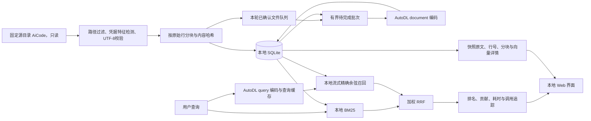

# OmniIndex：本地代码与文档混合检索

最新版全流程、关键机制、实测对照与详细示例见 [完整方案与实践指南](OMNIINDEX_SOLUTION.md)。质量评测、逐段日志与有界自动研究流程见 [检索研究说明](CODE_SEARCH_RESEARCH.md)。

OmniIndex 是独立于视频检索 Demo 的本地 Web 服务。它只读扫描指定目录，把符合规则的 UTF-8 文本和源码保存为 SQLite 快照，提供 BM25、向量和混合召回，以及文件原文、源行号、分块、向量数值和排名贡献的查看页面。默认入口为 **http://127.0.0.1:8790/**。

这里的“整个 AiCode 目录”指扫描范围，不代表每一种文件格式都已经解析。PDF、Word、图片、音视频、Notebook 输出、依赖与构建产物等目前不会进入正文索引，详见[格式与排除规则](#格式与排除规则)。扫描完成也不代表向量化完成，应分别查看文件、分块和向量数量。

搜索页以问题输入为主，模式和项目可直接选择，文件类型、数量、权重与候选数在筛选设置中展开；全库统计集中在资料库。修改条件后，页面会注明旧结果尚未刷新，只有重新搜索才提交新条件。结果及覆盖警告保留查询当时的状态，并与实时资料库概况区分；历史链路、原文、任务和评测详情仍可按需展开。

## 安装与启动

在仓库根目录执行，使用 Python 3.11 或 3.12。启动脚本使用文件锁，面向 macOS / Linux。

```bash
python3.11 -m venv .venv-code-search
source .venv-code-search/bin/activate
python -m pip install -r requirements-code-search.txt
```

本地仅安装 Web、SQLite 与数组处理依赖；无需安装 PyTorch、模型权重或本地 GPU。已有 AutoDL 推理服务时，按下一节准备端点和私有密钥，然后交错扫描与向量化：

```bash
python scripts/run_code_search.py --root ~/AiCode --sync
```

只扫描、保存快照并建立 BM25 索引：

```bash
python scripts/run_code_search.py --root ~/AiCode --scan-only
```

`--scan-only` 无需 AutoDL 可用。打开网页选择 **BM25** 即可使用本地召回；如果没有已完成向量，混合模式会明确提示本次仅使用 BM25。

省略动作参数时只启动网页，随后可在网页提交任务：

```bash
python scripts/run_code_search.py --root ~/AiCode
```

可指定端口、数据目录和连接资料：

```bash
python scripts/run_code_search.py \
  --root ~/AiCode \
  --data-dir ./data/code-search \
  --port 8790 \
  --endpoint-file ./data/autodl/endpoint.json \
  --key-file ./data/autodl/inference.key \
  --sync
```

服务在前台运行，默认只监听 `127.0.0.1`；页面与 API 检查本机 Host、同源 Origin。它是本机使用的独立应用，当前没有面向多人共享的账户体系。一个数据目录同时只允许一个启动脚本实例。按 `Ctrl+C` 停止本地服务不会关闭 AutoDL GPU 实例或停止实例计费。

需要后台运行时使用管理入口。停止操作会核验进程命令和启动时间；日志在 `data/code-search/service.log`，索引会保留：

```bash
python scripts/code_search_control.py start --sync
python scripts/code_search_control.py status
python scripts/code_search_control.py stop
```

这些命令只管理本机 Web 服务。后台任务需要本机保持运行且能连接 AutoDL；停止本机服务不会关闭远端 GPU。

## AutoDL 连接资料

默认文件均相对于本仓库：

| 文件 | 用途 |
|---|---|
| `data/autodl/endpoint.json` | 已部署的推理服务地址 |
| `data/autodl/inference.key` | 推理服务 Bearer 密钥，必须属于当前用户且权限为 `0600` |

`endpoint.json` 格式如下，地址仅为占位示例：

```json
{
  "url": "https://your-inference-host.example",
  "status": "ready"
}
```

把已有的独立推理密钥文件复制到指定位置，不要把密钥写入源码、命令参数、README 或浏览器查询框：

```bash
mkdir -p data/autodl
install -m 600 /path/to/private/inference.key data/autodl/inference.key
```

使用 HTTPS；仅本机回环地址允许 HTTP。客户端拒绝重定向，不使用环境代理转发 Bearer 密钥。OmniIndex 明确绑定端点文件，关闭历史 `OMNI_INFERENCE_URL` 地址覆盖；密钥和端点在请求时读取，更新连接资料通常无需重启。不会读取 AutoDL 账户 Token，也不会因推理失败而下载或改用本地模型。

健康页调用带鉴权的 `GET /health/ready`，缓存 3 秒、请求超时 2 秒，不发起真实推理。`configured` 只表示本地连接文件存在，`ready` 才表示该次远程健康响应就绪且模型版本匹配。部署与实例管理见 [AutoDL 运维指南](AUTODL_OPERATIONS.html)。

远端文本编码使用 `media-literals-space-v1`：源码中精确的 `<|image|>`、`<|audio|>`、`<|video|>` 仅在模型输入阶段加可见空格，例如 `< |image| >`，避免被多模态处理器误认为缺少附件。文件快照、上传原文与 BM25 不变；真正的图片/视频接口保留媒体输入。成功响应和就绪状态带 `text_input_policy`；结合批次 `boot_id` 与部署记录可追踪实际策略。严格确认的缺媒体输入错误不会降级模型，未知推理错误与异常向量仍触发保护。详细复现及修复记录见 [研究说明](CODE_SEARCH_RESEARCH.md)。

## 数据流与存储设计



默认数据库为 `data/code-search/code-search.sqlite3`，与视频 Demo 的数据库独立。SQLite 使用 WAL，目录中还会出现 `-wal`、`-shm` 和 `.service.lock`。

备份优先使用 SQLite 自身的备份接口，它会读取一致的数据库视图并包含 WAL 中已提交的数据。需要直接复制文件时，先请求暂停，再停止本地服务并确认进程已经退出，然后复制数据目录。管理器提示“仍在等待正常退出”时不能把它当作已停止；当前远程批次可能仍在等待返回或提交。运行中仅复制主 `.sqlite3` 文件可能漏掉已提交的 WAL，逐个复制主文件与 WAL 也不能保证来自同一时刻。不要手工删除 WAL 来缩小备份。

旧库迁移、调整排除规则或清理旧产物前应保存可恢复备份。数据库备份包含源快照、查询与历史索引，当前库清理了不应索引的内容，并不意味着旧备份也同步清理。

| 数据 | 保存内容 |
|---|---|
| `files` | 相对路径、所属项目、扩展名、文件大小、mtime、SHA-256、状态、逐文件分块策略 `policy` 和完整文本快照 |
| `chunks` | 分块正文、原始起止行、顺序、哈希、实际编码文本及 FTS rowid 映射 |
| `chunk_fts` | 预分词后的路径与正文，供 SQLite FTS5 BM25 使用 |
| `vectors` | 分块关联、固定模型版本、768 维 float32 小端向量 |
| `jobs` / `meta` | 持久任务进度、跳过原因、扫描摘要、根目录和分块策略版本 |
| `batches` | 每次编码批次的输入摘要、数量、字符数、阶段、HTTP 状态、耗时与结果 |
| `job_errors` | 按任务保存的错误路径、原因短码和目录标识，不被跳过样例上限挤占 |
| `traces` | 查询参数、召回排名、贡献和耗时，保留最近约 1000 次调用；含每路截取后候选的 ID、排名与分数，词项路另存原始 BM25 分和重排分 |

数据库绑定其源目录；同一数据库不能直接切换到另一根目录。需要索引其他目录时另选 `--data-dir`。

FTS 更新使用分块保存的 rowid 定位，新增文件不会先全表扫描 FTS 执行空删除。旧库首次打开时迁移映射与策略字段，迁移不会要求重新编码已经确认兼容的向量。

概况与范围覆盖使用仅包含元数据和关联键的覆盖索引，避免为统计数量读取正文和向量 BLOB。首次升级会自动补建索引，需要额外的磁盘空间与初始化时间，不会重新编码。无筛选覆盖率仅在验证外键定义及关联完整性后采用同一快照的独立计数；未验证的只读快照和存在异常关联的旧库保留精确关联查询。

重新扫描会替换当前快照。历史检索记录保留当次参数、候选排名与得分，不保留每一版源文件；再次点击历史查询会在当前索引上重新运行。

页面按数据库 ID 读取快照，不接受任意磁盘路径下载。文件后来被修改或删除时，详情页仍显示上一次扫描的快照；重新执行 `scan` / `sync` 才更新索引。这样结果行号对应的是产生该结果的快照，不会悄悄跳到磁盘上另一个版本。

## 格式与排除规则

扫描不执行文件内容，也不会把 `AGENTS.md`、README 或其他资料中的文字当成运行指令。文本通过 UTF-8 严格解码，未知扩展名也必须通过文本校验。默认单文件上限 **1 MiB**，空文本没有可召回分块。

分块按源行切分，目标为 2400 字符，最多重叠 6 行；过大的重叠区域会缩短。每个分块保存从 1 开始的 `start_line` / `end_line`，正文可与快照中的相同行范围核对。实际编码文本增加文件路径和行范围上下文，最长 8192 字符；超过编码上限的单独一行会使整个文件以 `overlong_source_line` 跳过，不会用截断正文冒充完整索引。

主要排除规则如下，实际逐项原因见任务 `details.skip_reasons`、跳过样例与扫描摘要：

| 类别 | 主要例子 |
|---|---|
| 版本库与依赖 | `.git`、`.svn`、`.hg`、`node_modules`、`venv`、`.venv`、`site-packages` |
| 构建、运行与缓存目录 | `out`、`dist`、`build`、`target`、`.next`、`.nuxt`、`.pio`、`.cargo`、`.rustup`、`cache`、`logs`、`runtime`、`.data` |
| 工具生成目录与包 | `*.xcresult`、`*.app`、`*.dSYM`、`ModuleCache.noindex`、`DerivedData`、`.build`、`.swiftpm`、`Pods`、`.svelte-kit`、`.vite`、`playwright-report`、`test-results` |
| 生成文件 | `*.lock`、`package-lock.json`、`pnpm-lock.yaml`、`yarn.lock`、`*.min.js`、`*.min.css`、`*.map`、常见 embedding/vector cache 文件名 |
| 敏感路径 | 所有 `.env*` 文件和目录（包括 `.env.example`）、`*.pem`、`*.key`、凭据/secret 文件、私钥目录、端点和控制配置 |
| 内容特征 | 私钥、常见服务 Token、JWT、带实际密码的连接串及疑似密钥赋值，包括 `AWS_SECRET_ACCESS_KEY`、`AWS_SESSION_TOKEN`；命中后整个文件正文和分块均不保存、不上传 |
| 不支持的内容 | PDF、DOC/DOCX、XLS/XLSX、PPT/PPTX、图片、音视频、压缩包、模型、数据库、Notebook、非 UTF-8 文本、含二进制特征的数据 |
| 文件类型和大小 | 符号链接、FIFO 等特殊文件、超过 1 MiB 的文件、超长单行 |

`.data` 默认视作运行历史目录排除，包括 `OmniVoice/.data`；普通 `data` 目录仍保留。Swift 的 `.build` / `.swiftpm`、CocoaPods 依赖 `Pods` 和前端缓存使用精确目录规则排除；不会笼统排除可能保存有效验收资料的 `outputs` 目录。目录在递归读取其后代之前剪枝，避免先解析大量运行轨迹再决定不索引。已有旧库需要按相同规则清理此前入库的产物，新增规则不会使历史向量自动失去关联。

普通 `config` 代码目录和 `tokenizer.py` 仍可进入索引，不能只因名字包含某个词就排除所有有效代码。连接串密码完整写为 `${VAR}`、`$VAR`、`{{...}}` 或 GitHub `${{ secrets.NAME }}` 时，仅豁免这个模板凭据；同一文件其它位置的真实凭据仍会拦截。

检查同时覆盖正文及增加文件路径、行范围后的实际 `embedding_text`。如果文件名本身含有凭据形状，该文件会被隔离，诊断路径替换为摘要标记，避免文件名泄漏或让一个坏分块中断其它文件的向量化。上传前会再次验证库内分块；不符合当前规则的历史项整文件清空正文与分块，记录原因后继续处理其它文件。

凭据检测属于特征过滤，不能证明任意文本均不含业务秘密；符合规则的分块正文会发送到已配置的 AutoDL 推理端点。

当前没有 PDF/Office 解析、OCR 或音视频转写。需要覆盖这些格式时，应增加专门的解析插件，并保存页码、段落或时间戳等来源定位；先把二进制文件读成字符串不能解决“全内容检索”。

## 三种召回与白盒解释

**关键词召回** 在本地 SQLite 执行，无需 GPU、AutoDL 或在线读取原文件。底层仍是 FTS5 BM25（路径权重4、正文权重1），查询保留完整标识符、camelCase组件和中文主题双字；长中文意图放宽时仍要求主题证据，不再退化成只搜项目名。少量公开的软件术语提供中英扩展；不同计划全部执行后合并，搜索解释目前只保存最后一个计划表达式和综合规则，尚未逐项保存全部执行计划。

词项路先扩大内部候选，再结合主题覆盖、正文证据距离、标题、精确项目、README入口及归档/当前路径进行可解释重排。`raw_bm25_score`保留原始BM25分，`lexical_score`是乘以公开特征后的词项路分；二者不能混称原始BM25。路径先验只是启发式，`docs/current`目录中的内容也可能是尚未实施的提案，用户仍需阅读原文的状态和日期。结果对长度足够的正文按哈希归并跨分支副本，并保留来源；每文件优先展示最多3个不同片段，避免重复文件占满结果，也避免把真正答案段挤掉。

**向量召回** 先经 AutoDL 编码查询，再在本地扫描已完成的同模型、同版本向量，计算归一化后的精确余弦相似度。尚未向量化的分块不会出现在该路结果中。

查询响应及追踪的 `routes` 保留每路截取到 `candidates` 的候选，最终结果数量 `limit` 不会再裁掉审计候选；它不包含全部内部 FTS 候选池。`explanation.coverage` 按本次项目与扩展名过滤范围统计向量覆盖。显式单路模式中的贡献等于该路实际得分；请求混合模式时使用 RRF，权重为 0 或 1 时也仍是单路 RRF 分数。

**混合召回** 独立取每路候选，再以加权 RRF 融合。设向量权重为 `w`、排名从 1 开始：

```text
score(chunk) = w / (60 + vector_rank)
             + (1 - w) / (60 + bm25_rank)
```

缺席某一路的贡献为 0。默认 `w=0.6`。这是排名融合分数，**不是相关概率**，也不是把 BM25 原始分数和余弦分数直接相加。仅向量模式展示余弦分数，仅 BM25 模式展示该路的分数；不同查询之间也不应直接比较这些值。

每次查询可查看原始BM25/向量分数、词项重排特征、各路排名、RRF贡献、去重来源、命中词、有效召回模式、候选数量、过滤范围和耗时；分块详情可查看向量范数、维度及768个数值。默认混合模式在本次范围的向量未补齐时，明确仅使用词项路并返回`effective_mode=bm25`与覆盖警告，同时跳过查询编码，避免不均匀向量覆盖扭曲默认排名。范围向量补齐后自动恢复混合；按已完成的项目过滤可更早使用完整混合召回。

显式向量模式和`vector_weight=1`仍允许探索已完成的部分向量，并明确警告覆盖不完整，不能据此比较全库质量。AutoDL查询编码失败时混合模式明确降级；仅向量模式返回错误。`vector_weight=0`完全使用本地词项路。没有本地模型回退。

入库使用 `document` 任务，查询使用 `query` 任务。远端分别应用 `title: none | text: …` 和 `task: search result | query: …` 前缀。两端固定 `google/embeddinggemma-2`、revision `914f7f89142e33e77833254d9c9b90c3cef7303b`、768 维；版本或维度不匹配会被拒绝，不能把不同模型空间的向量混在同一个索引中。

## 任务、暂停与增量更新

| 动作 | 行为 |
|---|---|
| `scan` | 扫描与过滤、保存快照、按行分块、更新 FTS；不调用 GPU |
| `embed` | 只处理数据库中尚未完成或模型空间不匹配的分块；不重新读取源目录，上传前重新检查路径与编码文本 |
| `sync` | 扫描期间交错执行有界向量批次，扫描结束后处理剩余有效分块 |

同一时间只有一个导入任务。`sync` 每累计至少 128 个新增分块、100 个文件或约 2 秒扫描工作，就尝试执行一个有界批次，然后返回扫描；不会为了先处理旧库全部待编码项而饿死目录遍历。阈值在文件边界检查，慢文件和正在进行的远程请求可能使实际间隔超过 2 秒。

扫描尚未结束时，仅向量化本轮已确认通过过滤的文件；尚未重新检查的旧快照不会抢先上传。完整扫描后处理剩余有效分块。若目录读取失败而推迟了全局删除清理，本次最终编码仍只处理已确认文件；未确认旧快照的 pending 数量保留在 `details.deferred_unconfirmed`，等待修复后的 `sync`。

每个远程批次不超过 16 个分块、总文本不超过 32768 字符。成功返回并校验后的向量与成功批次审计在**同一个 SQLite 事务**中提交，避免只有向量而没有执行记录。若提交完成前后发生暂停，已有批次不会丢弃；正在执行的远程请求需等返回或超时。服务停止也会为当前批次留出正常结束与提交时间。

| 状态 | 含义和后续操作 |
|---|---|
| `running` / `cancelling` | 正在运行，或等待当前工作边界后暂停 |
| `paused` | 用户主动暂停；重新提交 `embed` / `sync` 继续 |
| `failed` | 某个批次或数据库操作失败；已提交数据保留，排除问题后重新提交 |
| `interrupted` | 服务重启时发现之前未结束的任务；重新提交动作续跑 |
| `partial` | 任务结束但存在读取错误或损坏的历史编码项；查看详情后修复问题并重新扫描 |
| `completed` | 本次所选动作已完成；`scan` 完成不意味着向量已全部完成 |

再次运行 `--sync` 会复用哈希与分块策略未变化文件的既有向量，只编码仍然缺失的分块。需要只继续已有快照的向量化时提交 `embed`。暂停或重启本身不会重新编码已提交的向量；源文件发生变化时会重建该文件的分块并清理旧向量。完整扫描后会清理已删除文件的 FTS 与向量；扫描中途取消不会据此删除尚未遍历的文件，目录读取错误会推迟删除清理。

敏感内容发生变化时，重新扫描会撤销该文件的旧正文和向量。复用依据是每个文件自己的 `files.policy` 与内容哈希，`meta.chunk_policy` 仅为全局说明；某处目录读取失败不会使其它已确认文件反复重建和付费编码。策略升级即使源文件哈希未变也会重建分块。旧库仅在已有全局策略明确匹配受支持版本时继承策略；未知策略重新扫描确认。

远端超时或 500 错误不会由导入层无限重放；推理客户端仅对 429 执行有界重试。已提交批次可复用；如果远端已完成计算但响应丢失，或进程在收到结果后提交前异常退出，该批次仍会处于 pending，重试可能再次计算。这种请求结果不确定的情况不能承诺跨网络、跨进程的恰好一次计费。

### 进度、排除详情与批次审计

扫描中 `files_done` 表示已发现并处理的文件，`files_total` 仍会增长，不能据此把整个目录标成 100%。`details.scan_complete` 仅在扫描循环正常结束后为 `true`；`details.interleaved` 标记本任务是否交错执行，`last_work_phase` 在暂停或失败后保留最近工作阶段。文件扫描进度、本任务编码进度和全库向量覆盖率分别展示，不能混为一个百分比。

`vectors_done` 是本任务新提交的向量数，`vectors_total` 是随扫描发现、源变更与隔离动态调整的本任务工作量，不包含原本已经完成且复用的向量。全库是否向量化完整，应看当前过滤范围的向量数 / 分块数；扫描未结束时，也不能把该覆盖率视为整个源目录的覆盖率。`batches_succeeded`、`batches_failed` 与 `last_batch` 提供本任务最近批次概况。

排除详情可以按原因、项目和路径关键字筛选，返回元信息，不返回被排除的正文。任务保留 `skip_reasons` 汇总与前 80 个跳过样例；读取错误另存 `job_errors`，并在 `error_samples` 中显示最多 200 个样例，不会被普通排除项挤掉。目录剪枝按一次排除事件计数，不假装已遍历其内部文件数。

批次审计保存数量、总字符数、来源阶段、开始/结束时间、耗时、实际 HTTP 状态、错误类型短码、远端 `boot_id`，以及每项的 `chunk_id` 和 **实际上传 `embedding_text` 的 SHA-256**。审计不保存输入正文、服务地址、密钥或远端原始错误体。`http_status=null` 表示该记录没有可用的真实状态码，不能把本地错误映射码当成远端实际返回值，也不能仅凭它断言对端从未响应。2026-10-18 的维护修复保留了已收到响应后发生读取中断时的状态码；该修复已随21:25正常服务重载生效；历史记录不回填猜测值。审计摘要用于对应输入，不能替代历史源内容备份。

## API 使用

API 与页面共享本地服务，不要求把 AutoDL 密钥放进客户端请求。以下示例均不含密钥：

```bash
curl http://127.0.0.1:8790/api/code/overview

curl -X POST http://127.0.0.1:8790/api/code/search \
  -H 'Content-Type: application/json' \
  -d '{"query":"SQLite 如何保存向量","mode":"hybrid","limit":10,"candidates":100,"vector_weight":0.6}'

curl -X POST http://127.0.0.1:8790/api/code/jobs \
  -H 'Content-Type: application/json' \
  -d '{"action":"embed"}'

curl -X POST http://127.0.0.1:8790/api/code/jobs/cancel

curl 'http://127.0.0.1:8790/api/code/exclusions?reason=too_large&limit=20'
curl 'http://127.0.0.1:8790/api/code/batches?limit=20'
```

| 方法与路径 | 用途 |
|---|---|
| `GET /api/code/overview` | 文件、分块、向量、项目、扩展名、空间占用与扫描摘要 |
| `GET /api/code/health` | 远程就绪状态与当前任务 |
| `POST /api/code/search` | 三种召回；可传 `project`、`extension` 过滤 |
| `GET /api/code/files` | 文件列表，支持 `project`、`q`、`limit`、`offset` |
| `GET /api/code/files/{id}` | 文件快照与分块列表 |
| `GET /api/code/chunks/{id}` | 原行范围、上下文和向量详情 |
| `GET /api/code/jobs` | 最新与近期任务 |
| `GET /api/code/jobs/{id}` | 单任务详情、批次汇总、最近批次与读取错误 |
| `GET /api/code/batches` | 最近批次审计；支持 `job_id`、`limit` |
| `GET /api/code/exclusions` | 排除详情；支持 `reason`、`project`、`q`、`limit`、`offset` |
| `POST /api/code/jobs` | 提交 `scan`、`embed`、`sync` |
| `POST /api/code/jobs/cancel` | 暂停当前任务 |
| `GET /api/code/traces` | 近期调用与排名解释 |
| `GET /api/code/evaluations` | 已保存研究和试验的状态、参数、范围与门槛 |
| `GET /api/code/evaluations/{id}` | 单轮详情、逐题结果与最近阶段事件 |

搜索 `limit` 为 1—100；每路 `candidates` 为 1—1000，且不得小于 `limit`。过滤项目名使用源目录下的第一层目录名，扩展名写作 `.py`、`.md` 等。

## 规模边界与下一步

向量召回每次以 2048 条向量为一批读取 SQLite，执行**流式精确扫描**，不会把全部向量复制成常驻内存矩阵，但时间复杂度仍随过滤后的向量数量线性增长，为 `O(N × 768)`。100 万条原始 float32 向量本身约占 3.07 GB，尚未计算文本、FTS、元数据、索引与 WAL；SQLite 不会自动把精确扫描变成 ANN 检索。

大目录应先使用项目和扩展名过滤，并实际测量延迟。降低 `candidates` 可减少候选保留与后续融合开销，但不会免去向量全扫描。查询向量缓存最多 128 条，有效期 10 分钟；它只复用相同模型版本下的查询编码，不能缓存或跳过本地召回扫描。后台入库与在线查询共享远程推理锁，任务繁忙时查询可能等待或明确降级。

此实现适合个人目录探索与召回原型，当前不承诺全目录下的多人低延迟。规模或并发继续增长时，可先做项目分片，再评估 ANN 扩展；保留 SQLite 中的源快照、版本和解释信息，便于验证替换前后的召回质量。

当前已有 17 题专项证据定位集、固定快照评测和开发集/留出集研究；结果也已有较长正文的精确哈希归并与每文件 3 个片段的软优先规则。下一步应扩大到 30—100 条真实查询，补充多答案、无答案、版本差异、分级 nDCG、延迟和成本；现有短片段、近重复和版本辨识仍有边界，不能把重复命中算作多个独立正确答案。实际指标及未通过的参数方案见 [完整方案第 8、9 章](OMNIINDEX_SOLUTION.md)。

## 白盒验收

- [ ] 先运行 `scan`，核对文件总量、跳过原因与范围；确认 PDF/Office/图片等未解析格式没有被计入“全内容完成”。
- [ ] 断开 AutoDL 后用 BM25 搜索符号或中文内容，核对命中词与文件路径。
- [ ] 打开任意分块，对照完整快照核对起止行、原文、上下文与向量维度/范数。
- [ ] 同一查询分别运行三种模式，手动用各路排名和权重复算 RRF 贡献；确认界面没有把分数称为概率。
- [ ] 向量化中暂停并续跑，核对已完成向量数量保留；重启后旧任务为 `interrupted`，再提交后继续缺失分块。
- [ ] 扫描未结束时观察首次成功编码批次；扫描总量未知时不应出现全任务 100%，暂停后仍能查看最近工作阶段和批次记录。
- [ ] 从成功批次取出某项 `chunk_id`，对其 `embedding_text` 计算 SHA-256 与审计摘要核对；原文被后来扫描替换时保留历史摘要而不假装可恢复旧内容。
- [ ] 修改或删除一份测试文件后重新扫描，核对旧快照、FTS 与向量清理；未重新扫描前仍应展示旧快照。
- [ ] 验证源文件不会被改写，符号链接与特殊文件不会被跟随，敏感文件不保存正文或上传。

独立自动化测试可复现为：

```bash
python -m pip install pytest httpx
python -m pytest tests/test_code_search.py tests/test_code_search_regressions.py tests/test_code_search_control.py -q
```

测试使用临时目录、SQLite 与模拟编码器验证入库、检索、API、迁移、交错编码与审计事务；测试通过不等于已经完成整个 AiCode 的真实向量化，也不构成真实业务检索质量或全目录吞吐评测。当前用例总数与通过情况以该命令输出为准，真实任务完成度以运行数据库中的持久任务与数量为准。
