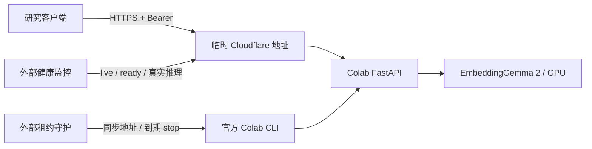

# Colab 上的 EmbeddingGemma 2 推理与健康监测

为内网推理服务实现相同健康协议，见 [本地推理服务健康接口实现说明](LOCAL_INFERENCE_HEALTH.md)。
健康页面提供本地电脑与 Colab 两个监测页签，各自独立启停；默认本地开启、Colab 停用。
内网服务使用独立配置与日志，不受 Colab 到期租约影响。

本实现把模型推理与原有 SQLite、上传、下载、检索服务分开。Colab 只运行
`omniembed.inference:create_app`，提供文本、单张图片和有界视频帧序列 embedding。视频走模型原生编码，不对单帧向量取平均。
客户端可以请求 768、512、256、128 维向量，截断后重新归一化。

## 运行边界

Colab 是研究计算环境，资源、会话时长和 GPU 可用性不保证。付费也不代表能够永久运行；
与交互式计算无关的独立 Web 服务仍受平台用途限制。公开端点供本人短期研究验证，
不把免费托管运行时当作生产服务。参见 [Google 官方 FAQ](https://research.google.com/colaboratory/faq.html)。

健康检查用于发现故障、确认恢复；没有模拟点击、虚假 GPU 负载、无限重连或自动重新申请运行时。
默认服务与监控窗口均为 7200 秒。停止服务进程不等于释放 GPU 虚拟机，必须执行
`colab stop`，或在 Colab 中断开并删除运行时。

T4 使用 FP32，原生支持 BF16 的 CUDA GPU 可使用 BF16；拒绝 FP16。
部署时固定 `OMNI_MODEL_REVISION` 为 Hugging Face 提交 SHA，健康和推理响应均返回该版本。
[官方模型说明](https://huggingface.co/google/embeddinggemma-2)

## 文件与职责

| 文件 | 职责 |
|---|---|
| `omniembed/inference.py` | 受保护 API、后台模型预热、输入约束、单请求推理、就绪状态 |
| `scripts/colab_serve.py` | VM 内服务监督、有限次数重启、可选临时隧道、到期停止 |
| `scripts/monitor_colab.py` | VM 外健康检查、失败/恢复阈值、JSON 状态、状态变更通知 |
| `omniembed/service_health.py` | 现有 Web 服务内的探测线程、最近 3 小时日志汇总；读取汇总不触发探测 |
| `scripts/colab_lease_guard.py` | VM 外租约监督、端点同步、到期释放并确认具名会话消失 |
| `notebooks/Colab_EmbeddingGemma2.ipynb` | 带校验源码包的自包含部署教程；默认仅 Colab 本机访问 |



## Notebook 使用

在 Colab 上传并打开 `notebooks/Colab_EmbeddingGemma2.ipynb`，选择 GPU 后按顺序运行。
Notebook 白名单打包当前代码并验证 SHA256，不依赖未推送的 Git 分支，不包含密钥、
数据库或模型权重。默认 `PUBLIC_EXPERIMENT=False`，只在 VM 内验证。
需要短期远程实验时显式开启该选项，并确认当前运行时允许该用途。

建议在 Colab Secrets 配置至少 32 个非空白字符的 `OMNI_INFERENCE_API_KEY`，
外部客户端与监控器使用同一个密钥。公开模型不需要 HF Token；需要认证时仅使用 Secrets
或隐藏输入，不要把令牌填入源码或输出。生成器：

```bash
python scripts/build_colab_notebook.py
```

Notebook 文件保持未执行状态；实际 GPU 验证应以运行时输出为准。

## 使用官方 CLI 部署

本机已经登录的 [Google Colab CLI](https://github.com/googlecolab/google-colab-cli)
可以创建专用会话、上传源码与私有密钥、安装 `requirements-colab.txt` 并执行启动器。
始终显式指定具名会话，避免操作其他任务的实例。`colab install` 使用现有 CUDA PyTorch；
Notebook 还会约束 torch / torchvision / torchaudio 版本，避免替换整套 CUDA 环境。

VM 内启动命令（密钥由权限为 `0600` 的文件提供）：

```bash
OMNI_MODEL=google/embeddinggemma-2 \
OMNI_MODEL_REVISION=<固定的模型提交SHA> \
OMNI_DEVICE=cuda \
python scripts/colab_serve.py \
  --key-file /content/omniembed.key \
  --endpoint-file /content/omniembed-endpoint.json \
  --port 8000 --max-runtime 7200 --public --release-runtime-on-expiry
```

启动器只监听 `127.0.0.1`，默认不公开；`--public` 使用经过 SHA256 校验的 Cloudflare
官方客户端建立临时 HTTPS 隧道。模型预热成功后才发布端点。隧道域名会变化，且没有可用性保证。
进程崩溃、推理超时卡死、连续三次本机 HTTP 无响应时最多重启三次。
隧道进程退出可重建；隧道仍存活但外部网络异常时由外部监控判故障，避免反复换域名。
参见 [Cloudflare 临时隧道说明](https://developers.cloudflare.com/tunnel/get-started/quick-tunnels/)。

`--release-runtime-on-expiry` 会在 VM 内请求释放运行时，但最终是否释放由外部租约守护确认。
外部守护所用电脑需保持运行和联网；需要更强保障时把守护和监控移到稳定主机。

## API

除 `/health/live` 外均要求 `Authorization: Bearer <key>`。密钥不进入 URL、端点 JSON 或日志。
API 禁用公开文档页，不提供任意 URL 下载或文件系统访问。

| 方法与路径 | 行为 |
|---|---|
| `GET /health/live` | 轻量判断 HTTP 进程存活，不运行模型 |
| `GET /health/ready` | 预热验证通过才返回 200；加载、降级、卡死返回 503 |
| `POST /health/inference` | 真正计算一条短文本，检查 `[1,768]`、有限数值、非零及单位范数 |
| `POST /v1/embeddings` | JSON 文本输入；`input_type=query` 自动加查询前缀，`document` 加文档前缀 |
| `POST /v1/embeddings/image?dimensions=768` | multipart `file`：JPEG/PNG/WebP，最多 10 MiB / 1600 万像素 |
| `POST /v1/embeddings/video?dimensions=768` | multipart `files`：按时间排列 1–8 帧，同尺寸 RGB；合计最多 32 MiB / 3200 万像素，使用原生视频编码 |

文本请求示例：

```json
{"input":["海边的日落","厨房里做饭"],"input_type":"query","dimensions":768}
```

响应包含 `data[].embedding`、`model`、`model_revision`、`dimensions`、`boot_id`。
每次最多 16 条文本，单条最多 8192 字符，合计最多 32768 字符。
`document` 可附 `titles` 数组，与 `input` 一一对应，保留标题语义；`query` 不接受标题。
同一时刻只允许一个推理请求，繁忙返回 `429` 和 `Retry-After`；客户端应有限退避重试。
默认推理超过 120 秒将标为 `stalled`，由监督进程重启；不会强行终止持有 GPU 的 Python 线程。

## 外部监控与租约

本次部署的连接材料保存在忽略 Git 的 `data/colab/`：

- `endpoint.json`：当前 HTTPS 地址、启动 ID、模型版本与到期时间。
- `inference.key`：私有 Bearer 密钥，权限 `0600`；不要提交或分享。
- `health.json`：最新健康检查、失败次数、延迟与最近真实推理成功时间。
- `probe-log.jsonl`：每轮探测一条结构化记录，不仅记录错误或状态变化；保留有界历史。
- `lease.json`：租约状态及释放确认。

### 复用现有 Web 服务

运行 `python -m omniembed serve` 后，现有 FastAPI 服务只对明确启用且已配置的监测目标
启动后台探测线程。网页的 **服务健康** 页按本地电脑与 Colab 分别展示最近 3 小时的实际记录。
不要同时运行另一个独立监控进程写入同一状态和日志文件。

`GET /api/service-health?profile=colab&hours=3&limit=180` 只读取历史和汇总，不触发网络或 GPU 推理。
省略 `profile` 时使用持久保存的页签；读取其他页签不会改变开关。
页面刷新以及 Codex 每 3 小时的巡检都只读取该接口；Web 不可达时，Codex 只读取本地最近
3 小时日志，不直接再次探测模型。告警仅针对启用服务的新故障、陈旧日志、恢复、重启或需要处理的状态。

`data/services/profiles.json` 仅保存两个监测开关与选中的页签，不保存密钥。
`PATCH /api/service-health/profiles/colab` 配合 `{"enabled":false}` 会取消后续健康请求，
并优先展示灰色 `DISABLED`，旧的 DOWN、陈旧日志或到期状态不会覆盖它。
已经发出的检查会自然结束，该轮取消后不会写成新的成功或故障。
停用仅关闭监测，既有租约守护仍负责释放 Colab；开关本身不创建、续租或释放实例。
Colab 到期或配置缺失时不能直接启用，需要先准备有效部署与连接信息。

本地电脑的端点、私有密钥和日志位于 `data/services/local/`，Colab 仍位于 `data/colab/`。
当前本地监测仅显式放行 `http://192.168.31.204:8770`，不会全局允许私网 HTTP。
页签与开关只控制观测；现有本地视频库可通过页面的“打开本地服务”入口访问。

日志窗口与探测频率是两回事：后台仍每 60 秒检查存活/就绪、每 300 秒验证真实向量。
窗口展示实际样本数和覆盖时间，刚部署不会伪造 3 小时历史。
启用服务最后一条探测超过 180 秒或没有记录时显示 `STALE` / `UNKNOWN`，不能把没有错误日志当作健康。
停用服务继续展示灰色 `DISABLED`，历史指标会明确标为历史。
样本成功率按成功探测数除以全部观测数计算，繁忙样本另列；它不是业务 SLA。
P50/P95 仅统计就绪探测耗时，包含网络往返，不代表纯模型推理延迟。

如果不运行网页服务，也可以在稳定主机独立运行同一个监控器，仅需 Python 标准库：

```bash
python scripts/monitor_colab.py \
  --endpoint-file data/colab/endpoint.json \
  --key-file data/colab/inference.key \
  --state-file data/colab/health.json \
  --log-file data/colab/probe-log.jsonl \
  --interval 60 --probe-interval 300 --max-runtime 7200
```

首次存活、就绪与真实推理检查均通过即判 `HEALTHY`。默认连续 3 次失败才判 `DOWN`；
实际故障、服务重启或更换端点后，连续 2 次成功才恢复 `HEALTHY`，期间显示恢复确认进度。
重启监测器会在重新验证当前实例后续接最近 180 秒内的同一实例观测，避免把监测器重启误报为服务恢复。
`429` 标为 `BUSY`，
加载状态给有上限的宽限；`degraded` 会继续低频真实探测，成功后恢复。
`401/403` 标为 `AUTH_ERROR` 并限频重试。启动 ID 改变报告 `RESTARTED`。
仅状态变化输出通知；完整状态原子写入文件。单次验证加 `--once`，退出码 0 表示该轮检查通过。
监控不发送邮件、Slack 或其他外部消息。

租约守护在同一外部主机运行，并使用独立的 CLI 会话状态：

```bash
python scripts/colab_lease_guard.py \
  --config data/colab/cli-sessions.json --session omniembed-inference \
  --endpoint-file data/colab/endpoint.json --state-file data/colab/lease.json \
  --max-runtime 7200
```

它同步已就绪的公网端点，到期只停止指定会话，不自动重新分配。
只有官方 CLI 确认该会话消失才记录 `RELEASED`；否则记录 `RELEASE_UNCONFIRMED`，需要人工处理。
提前停止并归还资源：

```bash
colab --config data/colab/cli-sessions.json stop -s omniembed-inference
```

## 接入当前项目并测试

项目通过 `OMNI_ENCODER_BACKEND=local|remote` 统一选择编码器。设置 `remote` 后，
视频入库、标题更新、文本召回、以图搜视频和评测均使用 Colab，不会在失败时下载本机模型。
默认仍为 `local`，当前工作区的 `.env` 已设置为 `remote`。

```dotenv
OMNI_ENCODER_BACKEND=remote
OMNI_MODEL=google/embeddinggemma-2
OMNI_MODEL_REVISION=914f7f89142e33e77833254d9c9b90c3cef7303b
```

默认连接文件为 `data/colab/endpoint.json`、私有密钥文件为 `data/colab/inference.key`，
可用 `OMNI_INFERENCE_ENDPOINT_FILE`、`OMNI_INFERENCE_KEY_FILE` 覆盖。客户端每次请求
重新读取连接材料，支持隧道换地址；密钥只发往已验证的 HTTPS 端点且不跟随重定向。
可用 `OMNI_INFERENCE_URL` 显式指定地址；超时由 `OMNI_INFERENCE_TIMEOUT_S` 配置。
请求 768 维并验证模型名、固定版本、索引顺序、有限数值和单位范数；繁忙仅有限次重试。

重启 `python -m omniembed serve` 后打开 [项目页面](http://127.0.0.1:8770/#ingest)，
上传 1–3 个短视频，等待“任务”显示完成，再到“召回”输入内容描述或上传图片。
先选“仅画面”检查视觉效果，再对比混合检索，避免标题相同掩盖视觉问题。
页面状态栏显示“Colab 远程推理”和最近业务调用成功时间，实时健康以“服务健康”页为准。

现有抽帧保留原分辨率，默认最多 8 帧；远端对总帧字节与像素数设有上限，
超限请降低素材分辨率或减少抽帧数。客户端无损传帧，不把单帧向量均值冒充视频编码。切换模型或版本前应重建向量，旧库只保存模型名，不能证明历史 revision。
测试基准需使用独立 `OMNI_DATA_DIR`，避免把评测素材混入业务库。

Codex 日志巡检改为每 3 小时；Web 的 60 秒轻探测、300 秒真实检查仍照常运行。
3 小时巡检会延迟聊天告警，不能替代独立的到期释放守护。
